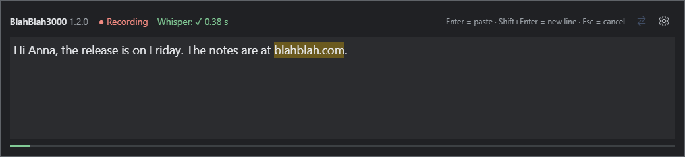

# BlahBlah3000

[](https://github.com/francbohuslav/blah-blah-3000/releases/latest)
[](https://github.com/francbohuslav/blah-blah-3000/releases)
[](LICENSE)


A small Windows tray application for dictation. Press a shortcut (or click the tray icon), speak, press Enter, and the
transcribed text is pasted into the window you were working in (or copied to the clipboard). Speech recognition runs
**locally** with [Whisper](https://github.com/openai/whisper) – no cloud service, no account, nothing leaves your computer.

*BlahBlah3000* is a talking machine from a retro-future that never quite happened: it listens to your blah blah and writes it down.

https://github.com/user-attachments/assets/528f03be-0424-4e83-8a71-72e19865091d



## Download

Get the Windows installer (`BlahBlah3000-Setup-X.Y.Z.exe`) from the
[latest release](https://github.com/francbohuslav/blah-blah-3000/releases/latest). It installs for the current user, no administrator
rights needed. You also need the [.NET 10 Desktop Runtime](https://dotnet.microsoft.com/download/dotnet/10.0).

## Features

- Resident tray application, optionally started with Windows (`--tray`).
- Built-in Whisper (`large-v3-turbo`, quantized) through [Whisper.net](https://github.com/sandrohanea/whisper.net),
  GPU-accelerated with Vulkan and a CPU fallback.
- Global shortcut (default `Win+Shift+D`): the text is pasted into the window that was active when you pressed it.
  Opening dictation from the tray icon copies the result to the clipboard instead.
- Optional push to talk (off by default, enable it in the settings): hold `Ctrl+Shift` (or Left/Right Ctrl, Left/Right Shift alone) for a configurable time and speak;
  every sentence is typed into the active window at the cursor, without opening the dictation window. The tray icon turns red
  while recording. Optionally the keys can be let go after the delay, and a second press stops the recording (latch mode).
  The computer's sound can optionally be lowered (or muted) while recording and put back afterwards.
  The text is typed as keyboard input, so it does not reach windows running as administrator, and the global
  keyboard hook it needs may be flagged by some antivirus products.
- Optional AI text correction in the dictation window (button or `Ctrl+K`, or automatically when you press Enter): the text is
  sent to an AI service of your choice with your own API key (any OpenAI-compatible endpoint: OpenAI, Groq, Gemini, xAI,
  OpenRouter, or a local one such as Ollama), the result is shown for you to check, and you can go back to the original.
  The instructions for the AI are editable. Off by default; the speech recognition always stays on your computer.
- Sentences are transcribed as you pause, so you see the text while you speak; you can edit it before pressing Enter.
- A free-text hint (terms, names, a style sample) that is passed to Whisper before every transcription.
- Replacements applied after transcription (e.g. "dot com" → ".com"), as plain text or, per row, as a regular expression; replaced text is highlighted and shows the original.
- Optional REST API so other applications on your machine (or network) can use the same model.
- Interface in English and Czech: it follows the Windows language and can be changed in the settings.
- First-run wizard: dictation language, model download (only after you agree) and shortcut check.

## Requirements

- Windows 10 or 11, x64
- [.NET 10 Desktop Runtime](https://dotnet.microsoft.com/download/dotnet/10.0)
- A microphone. A Vulkan-capable GPU is recommended; without one Whisper falls back to the CPU and is slower.
- About 900 MB of disk space for the model and about 1 GB of RAM/VRAM while it is loaded.

## Build and run

```
dotnet build
```

To publish a single-file build and start it:

```
build-and-run.cmd
```

The `runtimes` folder created by `dotnet publish` must stay next to `BlahBlah3000.exe` (it contains the native Whisper libraries).

## Updates

BlahBlah3000 checks GitHub for a newer release shortly after start and then once a day (it can be turned off in the settings).
It reads `releases/latest` of the repository, so a release is announced only when its tag is a version (`v1.2.0`) greater than
the one in `BlahBlah3000.csproj` (`<Version>`). When one is found, the dictation window shows a link at the bottom; after you
confirm, BlahBlah3000 exits and opens the release notes in your browser, where the Windows installer is attached.

To publish a version: bump `<Version>` in `BlahBlah3000.csproj`, create a GitHub release with the tag `vX.Y.Z` and attach the installer.

## Installer

`build-installer.cmd` publishes the app and builds a Windows installer with [Inno Setup 6](https://jrsoftware.org/isinfo.php)
into `installer\output`. The installer works without administrator rights (per-user install), offers a desktop shortcut,
checks for the .NET 10 Desktop Runtime and, on uninstall, can also remove the settings and the downloaded model.
The version comes from `<Version>` in `BlahBlah3000.csproj`.

## The Whisper model

The model `ggml-large-v3-turbo-q8_0.bin` (about 834 MB) is **not** part of the repository or the build. On the first run
BlahBlah3000 tells you it is missing and offers to download it from
[huggingface.co/ggerganov/whisper.cpp](https://huggingface.co/ggerganov/whisper.cpp). Nothing is downloaded without your
consent, and the download can be cancelled at any time. You can also place the file in
`%LOCALAPPDATA%\Bogan\BlahBlah3000\models\` yourself.

## Usage

| Action | Result |
| --- | --- |
| Global shortcut | Opens dictation; the text is pasted into the window that was active |
| Click the tray icon | Opens dictation; the text is copied to the clipboard |
| Hold the push-to-talk keys | Records; each sentence is typed into the active window as you pause (optional) |
| Enter | Finish: paste or copy the text |
| Shift+Enter | New line |
| Esc | Cancel |

Settings (tray menu → Settings, or the gear icon in the dictation window) cover the interface and transcription language,
the shortcut, autostart, the REST API, the microphone and its sensitivity, the Whisper hint and the replacements.

## REST API

Enabled by default on port `8221` (configurable). It listens on localhost only unless you turn on "Listen on the local network too" in the settings.

- `GET /health` → `{ "ok": true, "model": "ggml-large-v3-turbo-q8_0.bin", "state": "Ready" }` (HTTP 503 while the model is not usable)
- `POST /transcribe?prompt=&language=` with a raw PCM body (signed 16-bit little-endian, 16 kHz, mono, at most 2 minutes)
  → `{ "text": "...", "ms": 350 }`. `language` is a code such as `en` or `cs`; when omitted, the language from the settings is used.

```
curl -X POST --data-binary @speech.pcm "http://localhost:8221/transcribe?language=en"
```

The API has no authentication. Keep "listen on the local network" off unless you trust your network.

## Files

- Settings: `%APPDATA%\Bogan\BlahBlah3000\settings.json`
- Log, debug output and the model: `%LOCALAPPDATA%\Bogan\BlahBlah3000\`

## License

[MIT](LICENSE). The Whisper model is released by OpenAI under the MIT license as well.

## Credits

BlahBlah3000 builds on [Whisper](https://github.com/openai/whisper) by OpenAI,
[whisper.cpp](https://github.com/ggerganov/whisper.cpp), [Whisper.net](https://github.com/sandrohanea/whisper.net)
and [NAudio](https://github.com/naudio/NAudio).
